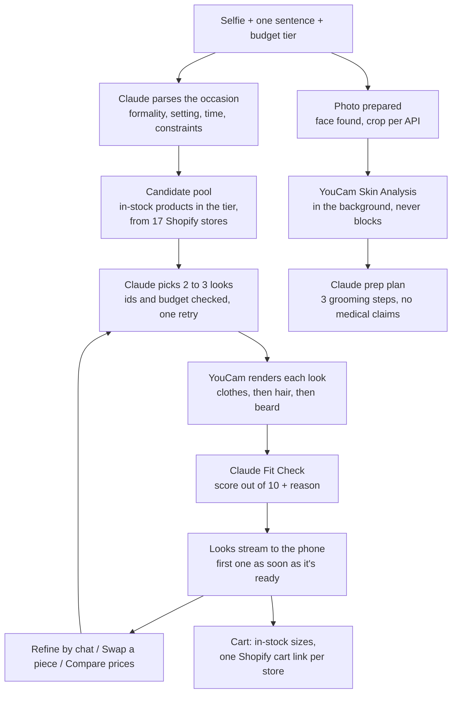

# Wingman

**Tell Wingman the occasion and see yourself ready: a full look from real stores, styled on your selfie and one tap from checkout.**

**Live demo:** https://wingman-eight-beta.vercel.app

Wingman is an AI occasion stylist for men, built for the YouCam API Skin AI & eCommerce VTO Hackathon (Perfect Corp). It picks 2 to 3 full looks from in-stock products at 17 Singapore Shopify stores, tries each one on your photo with YouCam, scores it, and opens each store's own cart with your sizes already in it.

## Try it in 60 seconds

1. Open https://wingman-eight-beta.vercel.app on your phone (or a narrow browser window).
2. Tap **Start with a photo** and upload a waist-up, front-facing selfie. Glasses are fine.
3. Keep "First date Friday night, rooftop bar, want to look effortless", pick **Mid-range** and tap **Style me**. The first look appears in about 30 seconds and the others follow.

What to look for:

- **The looks:** swipe through 3 complete outfits from real stores, each tried on your photo with a Fit Check score out of 10.
- **Compare prices:** the same look rebuilt at Budget, Mid-range and Luxury, side by side, with real SGD totals.
- **Refine and swap:** type "more casual" or "under S$500" in the bar at the bottom, or tap **Swap** on any piece for 6 alternatives that go with the rest of the look.
- **Prep plan:** a three-step grooming routine for the night before, based on a skin analysis of your photo.
- **Checkout:** **Add this look to cart**, pick in-stock sizes, and tap **Checkout at {store}**. The store's real cart opens with your pieces in it. You pay there; Wingman never takes payment.

> **On the live site, try-ons show a saved sample render** (`MOCK_YOUCAM=true`), so public visitors can't use up the hackathon's YouCam units. Everything else is live: occasion parsing, look selection, prices, stock, sizes and checkout. The screenshots below are real renders of the demo photo. "Try the demo" (a fixed, fully cached run) is not built yet; see [Limitations](#limitations-and-future-work).

## Screenshots

All at 390px, from a local run with live YouCam renders. Retake with `npm run screenshots`.

| | | | | |
|---|---|---|---|---|
|  |  |  |  |  |
| Home | Photo | Occasion | Styling | Looks |
|  |  |  |  |  |
| Price compare | Swap | Prep plan | Browse | Cart |

## YouCam APIs used

| API | What it does in Wingman | Units per call |
|---|---|---|
| AI Clothes Virtual Try-On (v3, `garment_category: auto`) | Puts each look's top or jacket on your photo. Also renders every tier in Price Compare and re-renders after a swap. | 2 |
| AI Hairstyle Generator (preset styles) | Gives each look a haircut that suits the occasion, applied on top of the outfit render | 1 |
| AI Beard Style Generator | Adds an optional beard style to the look | 2 |
| AI Skin Analysis (SD concerns) | Reads your skin so the night-before prep plan is about you, not generic tips | 9 for 4 concerns |

Bottoms, shoes and watches appear as product cards rather than renders: a waist-up selfie hides legs and feet, and YouCam's watch try-on needs a separate photo of the back of the hand.

Each API needs different framing, so Wingman takes one photo and the server prepares it: the full photo for clothes, a head-and-shoulders crop for hair, and a close face crop for beard and skin analysis. Claude finds the face so the crops land in the right place. Location data is stripped before anything leaves the server.

**Keeping units safe:** every live call reserves its units in Supabase first, and Wingman refuses any call that would pass `YOUCAM_UNIT_LIMIT` (700). Failed tasks release their units. Results are cached by photo, product, API and settings, so a repeat costs nothing; swapping trousers or shoes re-uses the cached render. Building the whole app has used 70 units.

## How the agent works



- **`POST /api/style`** streams progress as newline-delimited JSON, so the first look shows as soon as its render is done.
- **`POST /api/refine`**: Claude updates the brief ("more casual", "under S$300"), then look selection, renders and Fit Checks run again with the old looks as context. A budget cap opens the cheaper tiers.
- **`POST /api/swap/options` and `/api/swap`**: 6 in-stock alternatives for one slot that go with the rest of the look, then a re-render and new score.
- **`POST /api/compare`**: for each piece, products in the other tiers are ranked by colour, cut (shared name words like "linen") and formality; Claude picks the closest stand-in and says what changes at that price.
- **`GET /api/browse`**: the whole in-stock catalog, filtered by category, tier, price, colour family and size.
- **Checkout** builds `https://{store}/cart/{variantId}:{qty},...` per store ([`lib/cart.ts`](lib/cart.ts)). Only in-stock variants are offered; when a size repeats across colours the picker shows "White / Small" so the right colour lands in the cart.

**The catalog** comes from each store's public `products.json`. Each store is checked first (feed shape, a Shopify fingerprint, a working cart link). Claude Haiku tags every product (category, colour, formality, occasions) and picks its cleanest image for try-on. Prices are converted to SGD, and Budget, Mid-range and Luxury are computed per category from the catalog's own price spread, because Singapore menswear prices don't fit fixed thresholds.

## Tech stack

| Layer | Choice |
|---|---|
| Framework | Next.js 15 (App Router), TypeScript strict |
| Styling | Tailwind CSS 4, Panchang + Switzer fonts (self-hosted) |
| Database and storage | Supabase Postgres + private storage buckets with signed URLs |
| AI | Claude via `@anthropic-ai/sdk`: Sonnet 5.5 for styling, Fit Check and prep plans; Haiku 5.5 for catalog tagging |
| Vision | YouCam API, server-side only |
| Images | sharp |
| Validation | Zod on every API input and every Claude output |
| Products and checkout | Shopify `products.json` feeds and cart permalinks |
| Tests | Vitest (147 unit tests) and Playwright (smoke) |
| Deploy | Vercel |

## Setup

You need Node 20 or newer, a [Supabase](https://supabase.com) project, a YouCam API key ([docs](https://docs.perfectcorp.com)) and an [Anthropic API](https://console.anthropic.com) key.

**1. Clone and install**

```bash
git clone https://github.com/love98ed/wingman.git
cd wingman
npm install
cp .env.example .env.local
```

**2. Environment variables.** Fill in `.env.local`. Every key stays on the server.

| Variable | Where to get it |
|---|---|
| `YOUCAM_API_KEY` | YouCam API console, API Keys page (the API key, not the secret key) |
| `ANTHROPIC_API_KEY` | Claude Console |
| `SUPABASE_URL` | Supabase: Project Settings, then API |
| `SUPABASE_ANON_KEY` | Same page (optional; all database access is server-side) |
| `SUPABASE_SERVICE_ROLE_KEY` | Same page (keep this secret) |
| `SHOPIFY_STORES` | Leave empty; the store list lives in `fixtures/stores.json` |
| `MOCK_YOUCAM` | `true` serves saved YouCam responses from `fixtures/youcam/` (zero units). `false` for live renders |
| `YOUCAM_UNIT_LIMIT` | Hard cap on YouCam units (default 700) |
| `DEMO_MODE` | Reserved for the fixed demo flow (not built yet) |

**3. Database migration.** In the Supabase SQL Editor, run all of [`supabase/migrations/0001_init.sql`](supabase/migrations/0001_init.sql). It creates the catalog, render cache and unit log tables, the unit-reserve function and two private storage buckets.

**4. Catalog.** Fill the database with products (only one person at a time; it writes to the shared database):

```bash
npm run stores:check      # verify each store is a working Shopify store
npm run catalog:fetch     # fetch, tag, price and tier every product (resumable)
```

The tagging cache in `fixtures/catalog-cache/` is committed, so a fresh run mostly reuses it instead of re-tagging thousands of products. Expect a few minutes, longer if stores rate-limit.

**5. Run it.**

```bash
npm run dev
```

Open http://localhost:3000 at phone width and tap **Start with a photo**. `fixtures/selfies/demo.jpg` works as a test photo.

**Mock mode** (`MOCK_YOUCAM=true`): every try-on returns the saved sample render after a short delay, and skin analysis uses a saved response. Claude, the catalog and checkout still run for real. Use it for UI work so you spend no units.

**Demo mode** (`DEMO_MODE=true`): planned as a fixed golden path with the demo photo, the rooftop-bar occasion and Mid-range, served entirely from the render cache. Not built yet; the "Try the demo" button opens a placeholder.

**Deploying:** add the same variables to the Vercel project. Keep `MOCK_YOUCAM=true` on a public deployment unless you're happy for visitors to spend YouCam units (the unit guard still stops at the limit).

## Scripts

| Command | What it does |
|---|---|
| `npm run dev` | Start the dev server |
| `npm run build` | Production build |
| `npm test` | Unit tests (Vitest) |
| `npm run test:e2e` | Smoke test in a phone-sized browser (Playwright) |
| `npm run typecheck` | TypeScript check |
| `npm run lint` | ESLint |
| `npm run stores:check` | Verifies every store in `fixtures/stores.json` (products feed, Shopify fingerprint, cart link). Failing stores move to `fixtures/stores-removed.json`. |
| `npm run catalog:fetch` | Builds the catalog: fetches feeds, keeps menswear, tags with Claude, converts to SGD, picks try-on images and colours, assigns relative tiers, writes to Supabase. Resumable. `--store <domain>` for one store, `--dry-run` to skip writes. |
| `npm run photo:check` | Checks a photo before spending YouCam units: finds the face and writes the crops each API would get. |
| `npm run style:demo` | Calls `POST /api/style` with the demo photo and prints the looks, Fit Checks and prep plan. Start `npm run dev` first; `MOCK_YOUCAM` decides mock or live renders. Flags: `--tier`, `--occasion`, `--max-budget`, `--photo`, `--url`, `--compare` to also price-compare the first look, `--refine "more casual"` to refine the looks, `--swap shoes` to swap a piece of the first look. |
| `npm run catalog:colours` | Re-tags the colour of tops and outerwear from their try-on photo (text tags miss multi-colour products). Safe to re-run; new catalog runs already do this. |
| `npm run screenshots` | Captures every screen at 390px into `docs/screenshots/`. Start `npm run dev` first; with `MOCK_YOUCAM=true` every try-on is the saved sample. |
| `npm run youcam:smoke` | One real call per YouCam API on `fixtures/selfies/demo.jpg`. Saves responses for mock mode and prints units used. A second run costs zero units. |

## Project structure

```
app/                     Routes (App Router): / home, /style flow, /demo (placeholder until demo mode),
                         /occasion (redirects to /style), /api/style (style agent, streamed),
                         /api/compare (Price Compare, streamed), /api/refine (chat refine, streamed),
                         /api/swap (swap one piece, streamed), /api/swap/options,
                         /api/browse (catalog filters)
  fonts/                 Panchang and Switzer, self-hosted
  globals.css            Design tokens, type steps, motion
components/
  style/                 The style flow at /style: photo, occasion, loading (streamed progress), looks, price compare,
                         swap, refine bar, cart, prep plan, browse
  home/                  Home page sections: hero window, occasion list, look frames, Fit Check, how it works, footer
  shared/                Used across routes: placeholder screen, scroll-entrance helper
lib/
  agent/                 Style agent: occasion parsing, candidate pool, look selection, renders, Fit Check,
                         prep plan, refine (style.ts), swap (swap.ts) and Price Compare
                         (match.ts ranks tier stand-ins, compare.ts runs it)
  catalog/               Shopify feeds: fetch, filter, Claude tagging, prices in SGD, relative tiers, store checks,
                         browse filters (colour families, sizes)
  youcam/                YouCam client, unit guard, render cache, mock mode (index.ts is the entry point)
  llm/                   Claude model config and JSON-output helper
  photo/                 Face box and crops for each YouCam API; in-browser photo shrinking
  occasions.ts           Occasion choices and tier labels shared by home and the flow
  cart.ts                Cart permalinks per store, grouping, in-stock size choices
  supabase/              Server client (service role)
  env.ts, env.server.ts  Env validated with Zod; import env.server.ts from server code only
  hash.ts, pool.ts       sha256 helper, small concurrency limiter
  utils.ts               Tailwind class merging
scripts/                 Command-line tools (run with tsx, see Scripts)
supabase/migrations/     Database schema
fixtures/
  stores.json            Verified Shopify stores (failures go to stores-removed.json)
  catalog-cache/         Resumable tagging cache, one file per store
  shopify/               Saved products.json feed for tests
  youcam/                Saved YouCam responses for MOCK_YOUCAM
  selfies/               Demo photo and its credit
public/demo/             Before and after images for the home page
tests/
  unit/                  Vitest, mirrors lib/
  e2e/                   Playwright smoke tests
  stubs/                 Stand-ins for server-only modules under Vitest
docs/                    HANDOFF.md, STEP_PROMPTS.md (build plan), screenshots/ (390px, see npm run screenshots)
.taste-skill/            Design direction used by the design-taste-frontend skill
CLAUDE.md                Project rules for Claude Code
```

## Privacy

- Your photo goes to the server only to style you. Location data is stripped before anything is sent to YouCam.
- Try-on renders are kept in a private bucket and shown through links that expire after an hour.
- Every API key stays on the server; none reach the browser bundle.
- Store product images appear only as product cards linking back to the store.
- Prep plans are grooming tips only, with no medical claims.

## Limitations and future work

**Not built yet**

- **Demo mode and "Try the demo":** a fixed, fully cached run for judges and the video. The button opens a placeholder for now.
- **Photo auto-delete after 24 hours and a "Delete my photo" button.** Renders are private and links expire after an hour, but the files themselves are not deleted yet.
- **Live renders on the public site:** off to protect a 700-unit budget; the live site shows a saved sample render.

**Known limits**

- Only the top layer is rendered. Trousers, shoes and watches are product cards (a waist-up selfie hides them, and watch try-on needs a hand photo).
- 17 stores and about 5,000 products. Shoes and budget-tier pieces are the thinnest categories.
- Prices are converted to SGD with fixed rates in [`lib/catalog/fx.ts`](lib/catalog/fx.ts). A store that charges in USD shows its own price at checkout.
- Stock and prices are as fresh as the last `npm run catalog:fetch`.
- Skin analysis needs a straight-on face. When it fails (a tilted head, glasses), the prep plan is general rather than personal; it never blocks the flow.

**Future work**

- **Wingman Pay:** one checkout for a look that spans several stores, instead of one cart per store.
- **Affiliate links:** earn a commission on each store checkout to fund renders, so the public site can run live try-ons.
- **More stores:** more Singapore and regional Shopify stores, especially shoes and budget menswear, plus a scheduled catalog refresh.
- Full-body photos for trousers and shoes, a hand photo for the watch try-on, and saved looks to share before the event.

## License

[MIT](LICENSE)
