# Wingman

**Tell Wingman the occasion and see yourself ready: a full look from real Singapore stores, tried on your photo and one tap from checkout.**

**Live demo:** https://wingman-eight-beta.vercel.app

Wingman is an AI occasion stylist for men, built for the YouCam API Skin AI & eCommerce VTO Hackathon (Perfect Corp). It picks 2 to 3 full looks from in-stock products at 17 Singapore Shopify stores, tries each one on your photo with YouCam, scores it, drops any look that scores below 6, and opens each store's own cart with your sizes already in it.

## Try it in 60 seconds

1. Open https://wingman-eight-beta.vercel.app on your phone or laptop.
2. Tap **Start with a photo** and upload a waist-up, front-facing selfie. Glasses are fine.
3. Keep "First date Friday night, rooftop bar, want to look effortless", pick **Mid-range** and tap **Style me**. Each try-on fills in on the loading screen ("3 of 5 ready"), and your looks open once every one is ready, in about a minute. If one fails you can try it again or go on without it.

What to look for:

- **The looks:** swipe through 3 complete outfits from real stores, each tried on your photo with a Fit Check score out of 10.
- **Compare prices:** the same look rebuilt at Budget, Mid-range and Luxury, side by side, with real SGD totals.
- **Refine and swap:** type "more casual" or "under S$500" in the bar at the bottom and Wingman says in a sentence what it changed (it turns down requests it can't act on, like hats or a new hair colour, before spending anything), or open a look's **Additional** tab to **Swap** any piece for 6 alternatives that go with the rest of the look, or see **Cheaper** ones that cost at least 10% less.
- **Prep plan:** a three-step grooming routine for the night before, based on a skin analysis of your photo.
- **Checkout:** **Add this look to cart**, pick in-stock sizes, and tap **Checkout at {store}**. The store's real cart opens with your pieces in it. You pay there; Wingman never takes payment.

> Every try-on on the live site is a real YouCam render of your photo. The site caps itself at 700 YouCam units in total; once they're used, looks still arrive with their pieces and prices but without the try-on, until the cap is raised.

## Screenshots

All at 390px, from a local run with live YouCam renders. Retake with `npm run screenshots`.

| | | | | |
|---|---|---|---|---|
| 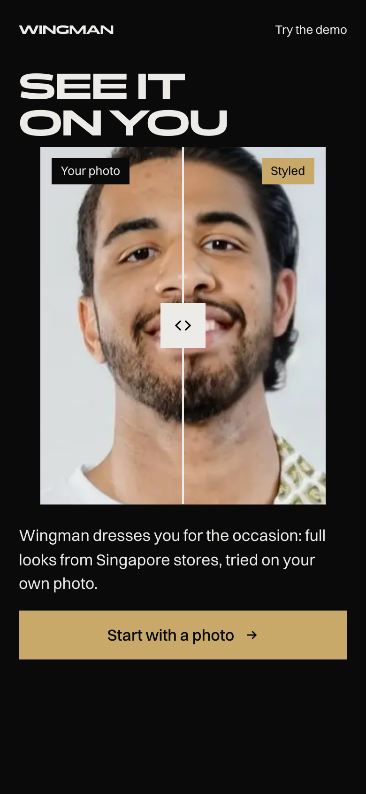 | 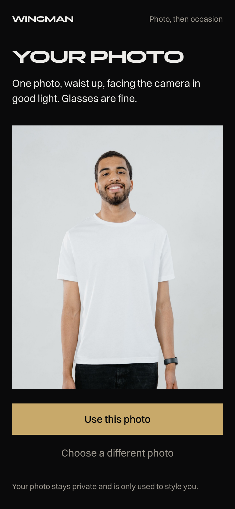 | 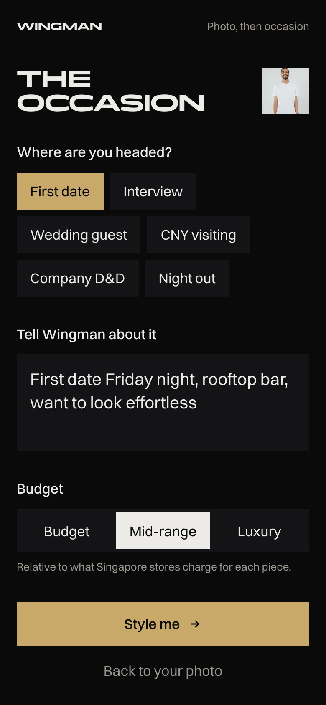 | 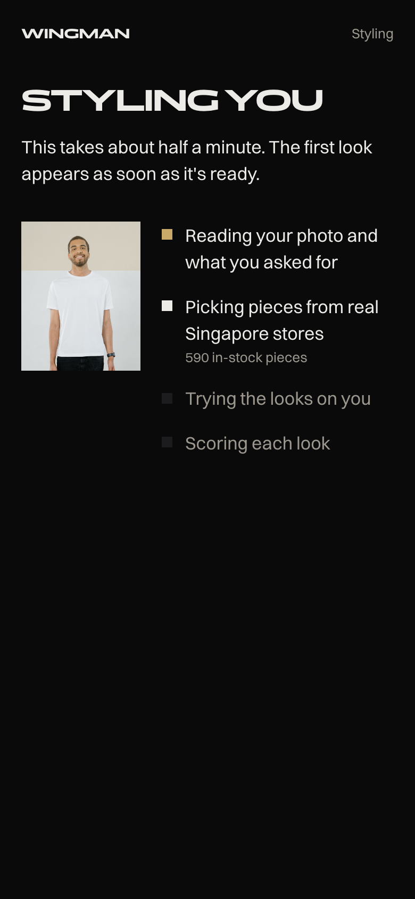 | 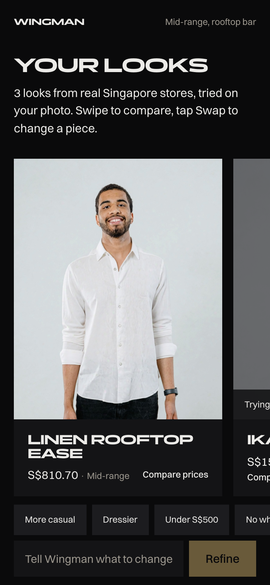 |
| Home | Photo | Occasion | Styling | Looks |
| 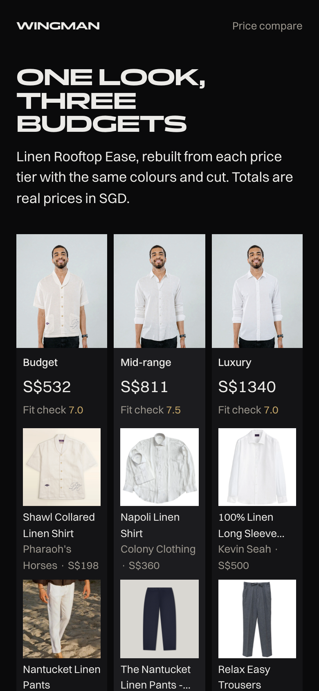 | 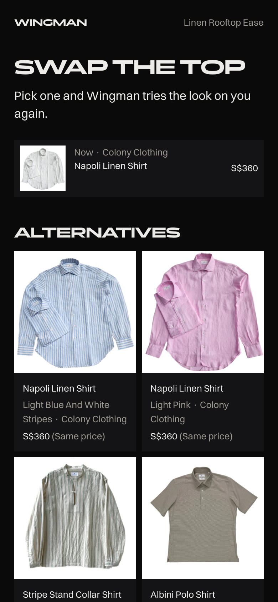 | 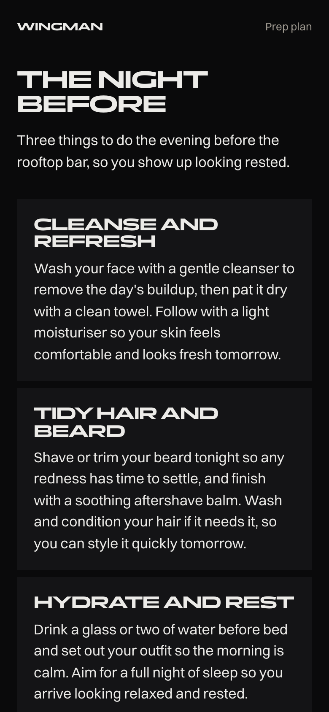 | 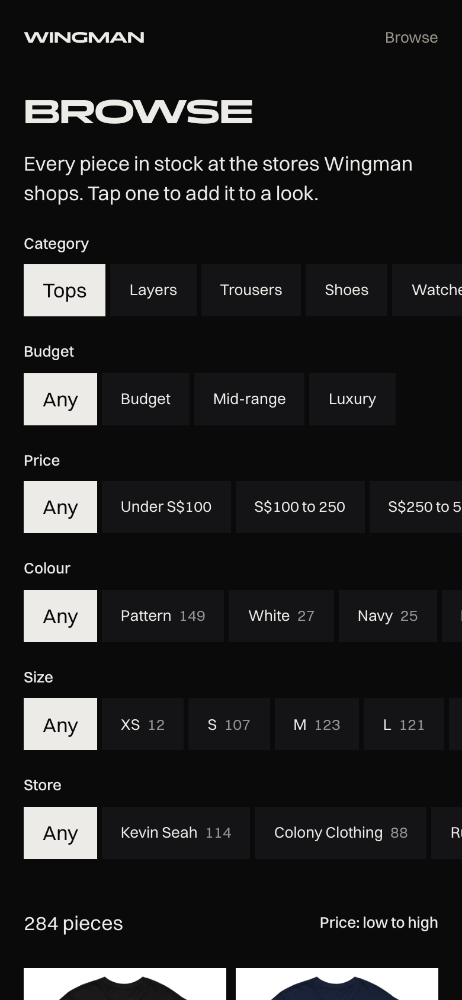 | 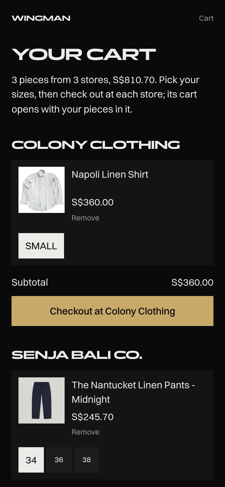 |
| Price compare | Swap | Prep plan | Browse | Cart |

## YouCam APIs used

| API | What it does in Wingman | Units per call |
|---|---|---|
| AI Clothes Virtual Try-On (v3, `garment_category: auto`) | Puts each look's top or jacket on your photo. Also renders every tier in Price Compare and re-renders after a swap. | 2 |
| AI Beard Style Generator | Adds an optional beard style to the look | 2 |
| AI Skin Analysis (SD concerns) | Reads your skin so the night-before prep plan is about you, not generic tips | 9 for 4 concerns |

Bottoms, shoes and watches appear as product cards rather than renders: a waist-up selfie hides legs and feet, and YouCam's watch try-on needs a separate photo of the back of the hand.

Each API needs different framing, so Wingman takes one photo and the server prepares it: the full photo for clothes and a close face crop for beard and skin analysis. Claude finds the face so the crops land in the right place. Location data is stripped before anything leaves the server.

**Keeping units safe:** every live call reserves its units in Supabase first, and Wingman refuses any call that would pass `YOUCAM_UNIT_LIMIT` (700). Failed tasks release their units. Results are cached by photo, product, API and settings, so a repeat costs nothing; swapping trousers or shoes re-uses the cached render. Building the whole app has used 70 units.

## How the agent works

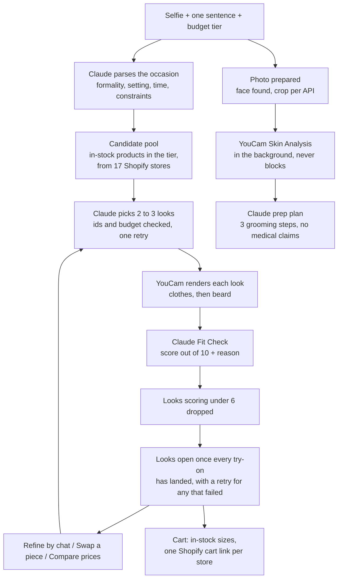

- **`POST /api/style`** streams progress as newline-delimited JSON: each try-on as it lands, any that failed, then a ready signal once the looks are scored.
- **`POST /api/photo/check`**: checks a photo when it's chosen (brightness, blur, and a Claude look at framing: one person, head in frame, shoulders visible, facing the camera) and says why one won't work, with a tip. No YouCam units.
- **`POST /api/refine`**: Claude first decides whether the request is something Wingman can do. Off-topic requests, changes to your body or hair colour, and things it doesn't sell (hats, bags, ties) are turned down with a one-line reply and an example of what to ask instead, before any units are spent. Otherwise Claude updates the brief ("more casual", "under S$300"), replies with what it changed, and look selection, renders and Fit Checks run again with the old looks as context. A budget cap opens the cheaper tiers.
- **`POST /api/swap/options` and `/api/swap`**: 6 in-stock alternatives for one slot that go with the rest of the look, then a re-render and new score.
- **`POST /api/compare`**: for each piece, products in the other tiers are ranked by colour, cut (shared name words like "linen") and formality; Claude picks the closest stand-in and says what changes at that price.
- **`GET /api/browse`**: the whole in-stock catalog, filtered by category, tier, price, colour family and size.
- **Checkout** builds `https://{store}/cart/{variantId}:{qty},...` per store ([`lib/cart.ts`](lib/cart.ts)). Only in-stock variants are offered; when a size repeats across colours the picker shows "White / Small" so the right colour lands in the cart.

**The catalog** comes from each store's public `products.json`. Each store is checked first (feed shape, a Shopify fingerprint, a working cart link). Claude Haiku tags every product (category, colour, formality, occasions) and picks its cleanest image for try-on. Prices are converted to SGD, and Budget, Mid-range and Luxury are computed per category from the catalog's own price spread, because Singapore menswear prices don't fit fixed thresholds.

## Tech stack

| Layer | Choice |
|---|---|
| Framework | Next.js 15 (App Router), TypeScript strict |
| Styling | Tailwind CSS 4, Panchang + Switzer fonts (self-hosted) |
| Database and storage | Supabase Postgres + private storage buckets with signed URLs |
| AI | Claude via `@anthropic-ai/sdk`: Sonnet 5.5 for styling, Fit Check and prep plans; Haiku 5.5 for catalog tagging |
| Vision | YouCam API, server-side only |
| Images | sharp |
| Validation | Zod on every API input and every Claude output |
| Products and checkout | Shopify `products.json` feeds and cart permalinks |
| Tests | Vitest (212 unit tests) and Playwright (smoke) |
| Deploy | Vercel |

## Setup

You need Node 20 or newer, a [Supabase](https://supabase.com) project, a YouCam API key ([docs](https://docs.perfectcorp.com)) and an [Anthropic API](https://console.anthropic.com) key.

**1. Clone and install**

```bash
git clone https://github.com/love98ed/wingman.git
cd wingman
npm install
cp .env.example .env.local
```

**2. Environment variables.** Fill in `.env.local`. Every key stays on the server.

| Variable | Where to get it |
|---|---|
| `YOUCAM_API_KEY` | YouCam API console, API Keys page (the API key, not the secret key) |
| `ANTHROPIC_API_KEY` | Claude Console |
| `SUPABASE_URL` | Supabase: Project Settings, then API |
| `SUPABASE_ANON_KEY` | Same page (optional; all database access is server-side) |
| `SUPABASE_SERVICE_ROLE_KEY` | Same page (keep this secret) |
| `MOCK_YOUCAM` | `true` serves saved YouCam responses from `fixtures/youcam/` (zero units). `false` for live renders |
| `MOCK_YOUCAM_FAIL` | Mock mode only: comma-separated APIs (`clothes`, `hair`, `beard`) whose first call per image fails, to see the retry screen |
| `YOUCAM_UNIT_LIMIT` | Hard cap on YouCam units (default 700) |

**3. Database migration.** In the Supabase SQL Editor, run [`supabase/migrations/0001_init.sql`](supabase/migrations/0001_init.sql), then [`0002_catalog_tags.sql`](supabase/migrations/0002_catalog_tags.sql). They create the tables (see [Database](#database)), the unit-reserve function and two private storage buckets.

**4. Catalog.** Fill the database with products (only one person at a time; it writes to the shared database):

```bash
npm run stores:check      # verify each store is a working Shopify store
npm run catalog:fetch     # fetch, tag, price and tier every product (resumable)
```

The first run tags about 5,000 products with Claude Haiku and checks their photos, which takes a while. Tags are saved to `catalog_tags` as it goes, so an interrupted run resumes and later refreshes only re-tag products whose text or photos changed.

**5. Run it.**

```bash
npm run dev
```

Open http://localhost:3000 at phone width and tap **Start with a photo**. `fixtures/selfies/demo.jpg` works as a test photo.

**Mock mode** (`MOCK_YOUCAM=true`): every try-on returns the saved sample render after a short delay, and skin analysis uses a saved response. Claude, the catalog and checkout still run for real. Use it for UI work so you spend no units.

**Deploying:** add the same variables to the Vercel project with `MOCK_YOUCAM=false`. [`vercel.json`](vercel.json) adds a daily cron that deletes expired renders.

## Scripts

| Command | What it does |
|---|---|
| `npm run dev` | Start the dev server |
| `npm run build` | Production build |
| `npm test` | Unit tests (Vitest) |
| `npm run test:e2e` | Smoke test in a phone-sized browser (Playwright) |
| `npm run typecheck` | TypeScript check |
| `npm run lint` | ESLint |
| `npm run stores:check` | Verifies every store in `fixtures/stores.json` (products feed, Shopify fingerprint, cart link). Failing stores move to `fixtures/stores-removed.json`. |
| `npm run catalog:fetch` | Builds the catalog: fetches feeds, keeps menswear, tags with Claude, converts to SGD, picks try-on images and colours, assigns relative tiers, writes to Supabase. Resumable. `--store <domain>` for one store, `--dry-run` to skip writes. |
| `npm run photo:check` | Checks a photo before spending YouCam units: finds the face and writes the crops each API would get. |
| `npm run style:demo` | Calls `POST /api/style` with the demo photo and prints the looks, Fit Checks and prep plan. Start `npm run dev` first; `MOCK_YOUCAM` decides mock or live renders. Flags: `--tier`, `--occasion`, `--max-budget`, `--photo`, `--url`, `--compare` to also price-compare the first look, `--refine "more casual"` to refine the looks, `--swap shoes` to swap a piece of the first look. |
| `npm run screenshots` | Captures every screen at 390px into `docs/screenshots/`. Start `npm run dev` first; with `MOCK_YOUCAM=true` every try-on is the saved sample. |
| `npm run youcam:smoke` | One real call per YouCam API on `fixtures/selfies/demo.jpg`. Saves responses for mock mode and prints units used. A second run costs zero units. |

## Project structure

```
app/
  page.tsx, style/             Home and the style flow (/occasion redirects to /style)
  not-found.tsx, icon.svg,     404 page, favicon and the link-preview image
  opengraph-image.jpg
  api/                         style, refine, compare, swap, swap/options (streamed), browse
  fonts/, globals.css          Self-hosted Panchang and Switzer; design tokens, type steps, motion
components/
  home/                        Home page sections: hero window (drag to compare), occasion picker, three budgets,
                               Fit Check, how it works, stores, footer
  style/                       style-flow.tsx runs the flow; flow-shell, refine-bar, product-image
    steps/                     One screen each: photo, occasion, loading, looks, compare, swap, cart, prep, browse, error
  shared/                      Scroll-entrance helper
lib/
  agent/                       The style agent
    flows/                     Route entry points: style.ts (style + refine), compare.ts, swap.ts
    pick/                      candidates.ts builds the per-slot pool; match.ts ranks tier stand-ins
    steps.ts                   Claude calls: occasion, look selection, Fit Check, prep plan, refine
    render.ts, grooming.ts     YouCam renders per look; hair and beard choices
    events.ts, schemas.ts      Streamed event types (shared with the browser); Zod schemas for input and Claude output
  api/stream.ts                Shared route plumbing: multipart photo + JSON in, newline-delimited JSON out
  catalog/
    types.ts, repo.ts          Product type; read and write the products table
    browse.ts, names.ts        Browse filters (colour families, sizes); display names
    pipeline/                  Catalog build: Shopify fetch, store checks, filter, Claude tags and tag cache,
                               image choice, SGD conversion, relative tiers
  youcam/                      YouCam client, unit guard, render cache, mock mode (index.ts is the entry point)
  llm/                         Claude model config and JSON-output helper
  photo/                       Face box and crops for each YouCam API; in-browser photo shrinking
  supabase/                    Server client (service role)
  utils/                       sha256, concurrency limiter, price formatting, class merging (knows the type steps)
  cart.ts, occasions.ts        Cart permalinks per store; occasion choices and tier labels
  env.ts, env.server.ts        Env validated with Zod; import env.server.ts from server code only
scripts/
  catalog/                     stores:check, catalog:fetch
  dev/                         youcam:smoke, photo:check, style:demo, screenshots
supabase/migrations/           Database schema (run in order)
fixtures/                      Verified store list, a saved Shopify feed, saved YouCam responses, demo photos
tests/                         unit/ (Vitest, mirrors lib/), e2e/ (Playwright), fakes/ and stubs/ for tests
docs/                          HANDOFF.md, STEP_PROMPTS.md (build plan), screenshots/
```

### Database

| Table | What it holds |
|---|---|
| `products` | The catalog: every in-stock menswear product with its SGD price, tier, tags, try-on image and variants |
| `catalog_tags` | Claude's tags and image picks per product, keyed by a hash of the product's text and photos, so a refresh only re-tags what changed |
| `render_cache` | YouCam results by photo, product, API and settings, plus cached Claude results (Fit Checks, tier picks); images live in the private `renders` bucket |
| `youcam_usage` | Every YouCam call and its units, for the unit guard |
| `selfies` | Not used: photos are never stored, only the renders made from them |

All tables have row-level security on and no policies, so only the server's service role key can read them.

## Privacy

- Your photo goes to the server only to style you and is never stored. Location data is stripped before it's sent to YouCam for the try-ons.
- Try-on renders are kept in a private bucket and shown through links that expire after an hour.
- Every render and cached result made from your photo is deleted after 24 hours: swept after each styling request and by a daily cron ([`lib/privacy.ts`](lib/privacy.ts)).
- "Delete my photo" (under your looks) deletes them straight away.
- Every API key stays on the server; none reach the browser bundle.
- Store product images appear only as product cards linking back to the store.
- Prep plans are grooming tips only, with no medical claims.

## Limitations and future work

**Budget**

- **No per-visitor limit.** The 700-unit cap is shared by every visitor, at up to 24 units for a full styling run.

**Known limits**

- Only the top layer is rendered. Trousers, shoes and watches are product cards (a waist-up selfie hides them, and watch try-on needs a hand photo).
- 17 stores and about 5,000 products. Shoes and budget-tier pieces are the thinnest categories.
- Prices are converted to SGD with fixed rates in [`lib/catalog/pipeline/fx.ts`](lib/catalog/pipeline/fx.ts). A store that charges in USD shows its own price at checkout.
- Stock and prices are as fresh as the last `npm run catalog:fetch`.
- Skin analysis needs a straight-on face. When it fails (a tilted head, glasses), the prep plan is general rather than personal; it never blocks the flow.

**Future work**

- **Wingman Pay:** one checkout for a look that spans several stores, instead of one cart per store.
- **Affiliate links:** earn a commission on each store checkout to fund renders, so the public site can run live try-ons.
- **More stores:** more Singapore and regional Shopify stores, especially shoes and budget menswear, plus a scheduled catalog refresh.
- Full-body photos for trousers and shoes, a hand photo for the watch try-on, and saved looks to share before the event.

## License

[MIT](LICENSE)
